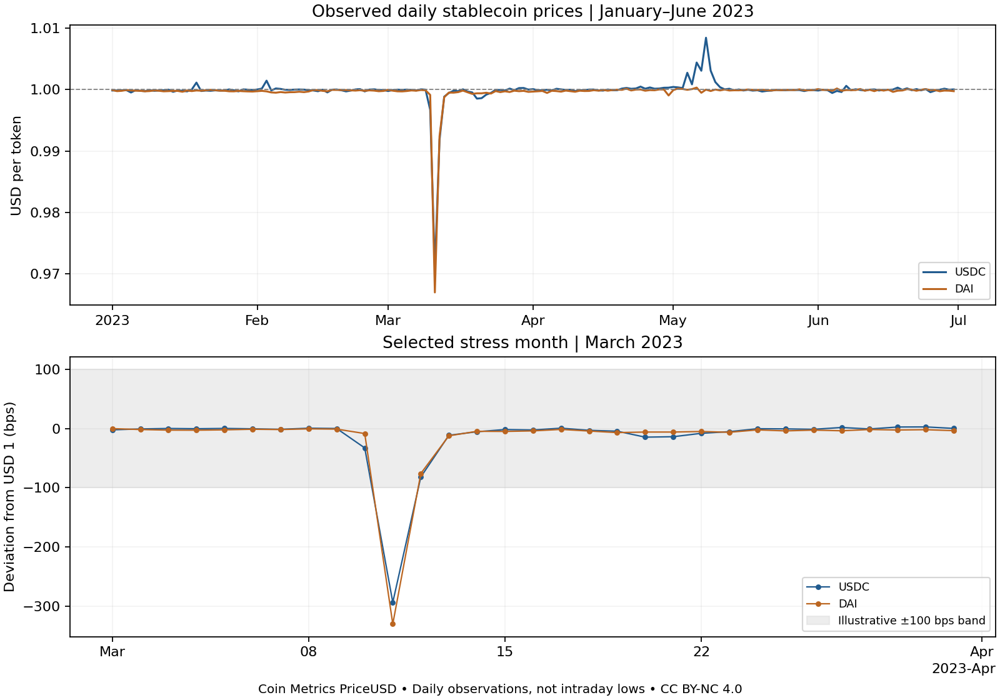

# Stablecoin Peg Risk Lab

[运行与最新验证](docs/validation-latest.md)

An AI-assisted educational study of **observed price deviations**, using real
public Coin Metrics USDC and DAI daily prices, 2023-01-01 to 2023-06-30.
It asks: how should a finance analyst measure deviations from USD 1 without
confusing market prices, redemption rights and investment returns?

## Run offline

Python 3.10+; core analysis and tests use only the standard library.

```text
python -m unittest -v
python analyze.py
```

The committed small data subsets make analysis reproducible without credentials.
Git attributes preserve LF line endings for the CSV snapshots on Windows and Linux,
so byte-level SHA-256 verification remains identical after a fresh clone.
Git attributes preserve LF line endings for the CSV snapshots on Windows and Linux,
so byte-level SHA-256 verification remains identical after a fresh clone.
Optional: `python download_data.py` re-downloads the same pinned upstream commit.
`pip install -r requirements-plot.txt` and `python plot_results.py` regenerate the chart.

## Evidence

- [Results and limits](results/RESULTS.md) and machine-readable [metrics](results/metrics.json).
- [Data manifest](data/manifest.json): source commit, source/subset SHA-256,
  observation count, window, extraction method and license.
- [Methods and interpretation](METHODS.md), [learning contribution](CONTRIBUTIONS.md).



## Implemented methods

- Strict positive, finite prices; duplicate-date rejection; explicit missing-day
  counts; no interpolation or invented market observations.
- Basis-point deviations, band exceedances, pre/stress/post descriptive comparison,
  50/100/200 bps sensitivity and three-consecutive-observation recovery confirmation.
- Prior-only rolling thresholds, with complete daily history required. These
  detect current observations; they do not predict a future depeg.
- A clearly hypothetical 10,000-token mark-to-peg valuation scenario.

## What this does not show

March 2023 was deliberately selected as a known stress period. It is not a random
test set, causal study, trained machine-learning model or profitable strategy.
Daily series can miss intraday extremes and cannot establish executable prices,
liquidity, reserves, legal redemption rights or issuer solvency. Historical data
may contain revisions; this snapshot is not a real-time vintage dataset.
Thresholds are illustrative, not regulatory limits. No accuracy claims are made
without verified incident labels. A near-par price does not establish safety.

## Application relevance

This is a course-based matching judgment, not a university portfolio requirement.
For CityUHK FTDA 2027 it supplies evidence of quantitative digital-asset exploration
and identifies gaps in blockchain, security and regulation; it does not prove
mastery of those subjects. For CUHK ECLT it is only a supplementary financial-risk
case; the order/payment reconciliation lab is a stronger primary example.

## Attribution and reuse

Data: **Coin Metrics**, https://github.com/coinmetrics/data, **CC BY-NC 4.0**,
https://creativecommons.org/licenses/by-nc/4.0/. Subsets select dates and columns
without changing values. Include attribution and retain noncommercial restrictions
when redistributing data or results; no endorsement is implied.
Code is original AI-assisted educational code (see LICENSE-CODE).
No personal, employer or customer data is included.
